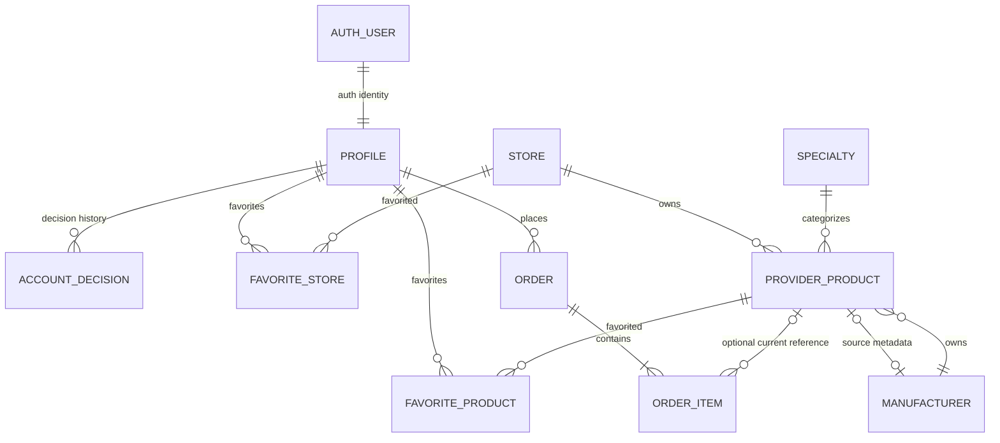

# MedSupply Supabase Data Model Audit

**Scope:** Analysis only. No SQL, migrations, UI, application logic, or schema implementation.

## 1. Existing Model Inventory

| Entity | Fields | Required / Optional | Identifier and current storage | Consumers |
|---|---|---|---|---|
| `User` | `id`, `fullName`, `email`, `phone`, `profilePicture`, `pharmacyName`, `pharmacyAddress`, `role`, `createdAt`, `accountStatus`, `rejectionReason`, `accountDecisions` | Core identity fields are required; profile picture, phone, pharmacy fields, account status, rejection reason, and decisions are optional in the model | Custom string IDs; AsyncStorage account/session keys | Login, registration, profile, pharmacist management |
| `AuthAccount` | `user`, `passwordHash` | Both required | AsyncStorage `medsupply.auth.accounts.v1` | Authentication |
| `AccountDecision` | `status`, `reason`, `decidedAt` | Reason optional | Embedded in `User.accountDecisions`; AsyncStorage | Decision-history UI |
| `Store` | Producer fields plus `openHours`, `rating`, `contactPerson`, `status` | Core producer fields; status/contact required | Custom string IDs in `MockDatabase` memory | Store browsing, management, favorites |
| `Factory` | Producer fields plus `certification`, `productionCapacity`, `contactPerson`, `status` | Core provider fields | Custom string IDs in `MockDatabase` memory | Manufacturer browsing/management |
| `Specialty` | `id`, `name`, `description`, `image`, `isActive` | `isActive` optional | Static `MockDatabase` array | Category browsing |
| `Product` | Name, description, image, specialty, seller, source-manufacturer metadata, barcode, dosage, package, variant, form, prices, discount, stock, availability, expiry | Many descriptive fields optional | Custom string IDs in `MockDatabase` memory | Listings, search, favorites, cart, orders |
| `CartItem` | Seller, product, quantity, pricing, dosage, package, variant | Core fields required | React/AppState memory only | Cart and checkout |
| `Order` | ID, pharmacist/customer, legacy seller fields, items, totals, status, timestamps, rejection reason, stock flag | Several fields optional | React/AppState memory only | Pharmacist/Admin orders |
| `OrderLineSnapshot` | Product/provider snapshots, quantity, prices, discount, line total | Dosage/package/variant/consumer/pricing fields optional | Embedded in `Order.items` | Checkout, order history, reorder |
| `CheckoutValidationIssue` | Product, stock, quantity, reason, old/current values | Change-value fields optional | Ephemeral React result | Checkout validation |
| `NotificationItem` | ID, title, message, read, createdAt | All required | Static React/AppState memory | Notifications screen |
| `Advertisement` | ID, title, description, image, background color, sort order | Description/background optional | Static `MockDatabase` array | Home carousel |
| `Pharmacy` | Name, description, image, address/location/phone, active/open hours | Mostly optional | Interface exists; mock array is empty | Currently not consumed |
| `FavoriteStore` | Store ID relationship | Not a separate model | React/AppState; default `store-1`; not persisted | Store detail/profile |
| `FavoriteProduct` | Provider-owned product ID relationship | Not a separate model | AsyncStorage per pharmacist | Search/detail/favorites |

## 2. Relationships

### Relationship Notes

- Products belong to exactly one Store or one Manufacturer.
- `manufacturerId`/`manufacturer` on store-owned products are source metadata, not provider ownership.
- Orders are owned by one pharmacist and may contain items from multiple providers.
- Provider grouping is visual only; order actions apply to the whole order.
- Order items require historical snapshots independent of current product/provider records.
- Cart items are transient and need no permanent table in the initial migration.
- Favorites refer to provider-owned product listings rather than a shared catalog.

## 3. Existing Business Rules

### Authentication and roles

- Supabase Auth is not currently used.
- Admin and pharmacist accounts are stored together in AsyncStorage mock account JSON.
- Built-in Admin: `admin@medsupply.app` / mock credential, custom ID `admin-1`.
- Pharmacist statuses: `pending`, `active`, `rejected`, `inactive`.
- Login blocks pending, rejected, and inactive pharmacists.
- Session restoration rejects pharmacists unless their status is active.
- Account decisions are embedded as approved, rejected, inactive, or reactivated records.

### Provider-owned products

- A listing belongs to a Store or Manufacturer.
- Provider and product IDs are custom mock strings.
- Duplicate validation uses normalized name plus dosage within the same provider.
- Different providers may list the same product name and dosage.
- Consumer price, discount, pharmacist price, stock, and availability are provider-specific.
- `pharmacyPriceAfterDiscount` is derived and recalculated from consumer price and discount.

### Orders

- One order belongs to one pharmacist.
- One order may contain items from multiple providers.
- Product/provider/pricing snapshots are stored inside order items.
- Status lifecycle: pending → approved, pending → rejected, approved → completed.
- Rejected and completed orders cannot be approved or processed normally.
- Rejection reason and timestamps are stored on the order.

### Inventory

- Checkout never deducts stock.
- Approval deducts stock once for the complete order.
- Duplicate approval is guarded by status and an in-memory approved-ID ref.
- Approval validates the full order before mutation.
- The mock implementation aggregates quantities and deduces only after full validation.
- Completion and rejection of approved orders do not deduct stock.

### Favorites

- Product favorites are keyed in AsyncStorage by pharmacist ID and contain provider-owned product IDs.
- Store favorites are currently only React state and have no persistence.
- Favorite product IDs remain separate when two providers list distinct listing IDs.

## 4. Proposed PostgreSQL Schema

### `profiles`

| Field | Type | Notes |
|---|---|---|
| `id` | `uuid` PK, FK `auth.users(id)` | Supabase identity |
| `legacy_id` | `text` unique | Preserve mock IDs such as `admin-1` and `pharmacist-*` |
| `role` | enum `user_role` | `admin` or `pharmacist` |
| `full_name` | `text` | Required |
| `email` | `citext` unique | Required |
| `phone` | `text` | Nullable |
| `profile_picture` | `text` | Nullable |
| `pharmacy_name` | `text` | Pharmacist-only |
| `pharmacy_address` | `text` | Pharmacist-only |
| `account_status` | enum `pharmacist_account_status` | Nullable for Admin |
| `rejection_reason` | `text` | Required for rejected status |
| `created_at` | `timestamptz` | |
| `updated_at` | `timestamptz` | Recommended |

### `account_decisions`

- `id uuid PK`
- `profile_id uuid FK profiles(id) ON DELETE CASCADE`
- `status enum account_decision_status`
- `reason text nullable`
- `decided_at timestamptz`

### `specialties`

- `id uuid PK`
- `legacy_id text unique`
- `name text not null`
- `description text`
- `image_url text`
- `is_active boolean default true`

### `stores`

- `id uuid PK`
- `legacy_id text unique`
- `name text not null`
- `description text`
- `image_url text`
- `address text`
- `location jsonb` initially
- `phone text`
- `contact_person text`
- `open_hours text`
- `rating numeric(3,2)`
- `status enum provider_status`
- `created_at`/`updated_at timestamptz`

### `manufacturers`

Same provider fields, plus:

- `certification text`
- `production_capacity text`

### `provider_products`

- `id uuid PK`
- `legacy_id text unique`
- `store_id uuid nullable FK stores(id)`
- `manufacturer_id uuid nullable FK manufacturers(id)`
- `specialty_id uuid FK specialties(id)`
- `name text not null`
- `description text`
- `image_url text`
- `dosage text`
- `package_size text`
- `variant text`
- `barcode text`
- `expiry_date date`
- `source_manufacturer_id uuid nullable FK manufacturers(id)`
- `source_manufacturer_name text`
- `consumer_price numeric(12,2) not null`
- `discount_percentage numeric(5,2) not null`
- `pharmacy_price_after_discount numeric(12,2)`
- `stock_quantity integer not null default 0`
- `is_available boolean not null default true`
- `created_at`/`updated_at timestamptz`

The current store-owned product's source-manufacturer metadata should remain descriptive and must not become provider ownership.

### `favorite_stores`

- Composite PK `(pharmacist_id, store_id)`
- `pharmacist_id FK profiles(id)`
- `store_id FK stores(id)`
- `created_at timestamptz`

### `favorite_products`

- Composite PK `(pharmacist_id, product_id)`
- `pharmacist_id FK profiles(id)`
- `product_id FK provider_products(id)`
- `created_at timestamptz`

### `orders`

- `id uuid PK`
- `legacy_id text unique`
- `pharmacist_id uuid FK profiles(id) not null`
- `customer_name_snapshot text`
- `total_items integer not null`
- `total_discount numeric(12,2) default 0`
- `total_price numeric(12,2) not null`
- `status enum order_status not null`
- `created_at timestamptz not null`
- `approved_at/rejected_at/completed_at timestamptz nullable`
- `rejection_reason text`
- `stock_deducted boolean not null default false`

Legacy order-level `sellerType`, `sellerId`, and `sellerName` should not be normalized as provider relations because normal orders are multi-provider. Omit unless backward compatibility requires them.

### `order_items`

- `id uuid PK`
- `order_id uuid FK orders(id) ON DELETE CASCADE`
- `product_id uuid nullable FK provider_products(id) ON DELETE SET NULL`
- `product_name text not null snapshot`
- `dosage text snapshot`
- `package_size text snapshot`
- `variant text snapshot`
- `seller_id text snapshot` (not a FK)
- `seller_name text snapshot`
- `seller_type enum provider_type snapshot`
- `consumer_price numeric(12,2) snapshot`
- `discount_percentage numeric(5,2) snapshot`
- `pharmacist_unit_price numeric(12,2) snapshot`
- `quantity integer not null`
- `line_total numeric(12,2) snapshot`

### Optional tables

- `advertisements`: migrate if the mock catalog is intended to become persistent.
- `notifications`: no existing persistence; defer until notification requirements are approved.
- `pharmacies`: interface exists but is unused and should not be migrated automatically.

## 5. Constraints and Derived Fields

### Enums

- `user_role`: `pharmacist`, `admin`
- `pharmacist_account_status`: `pending`, `active`, `rejected`, `inactive`
- `account_decision_status`: `approved`, `rejected`, `inactive`, `reactivated`
- `provider_status`: `active`, `inactive`
- `provider_type`: `store`, `manufacturer`
- `order_status`: `pending`, `approved`, `rejected`, `completed`

### Product constraints

- Exactly one provider owner:
  - Store owner when `store_id` is non-null and `manufacturer_id` is null.
  - Manufacturer owner when `manufacturer_id` is non-null and `store_id` is null.
- `consumer_price > 0`
- `discount_percentage >= 0 AND <= 100`
- `stock_quantity >= 0`
- Stock zero requires `is_available = false`.
- Name plus dosage uniqueness within each provider.
- Duplicate-name matching should use normalized name and normalized dosage.

### Order constraints

- Quantity must be positive.
- `stock_deducted` starts false and becomes true exactly once at approval.
- Rejection reason is required only for rejected status.
- Completed/approved/rejected timestamps must match status transitions.

## 6. Recommended Indexes

- `profiles(email)`
- `profiles(role, account_status)`
- `account_decisions(profile_id, decided_at DESC)`
- `provider_products(store_id)`
- `provider_products(manufacturer_id)`
- `provider_products(specialty_id)`
- `provider_products(is_available, stock_quantity)`
- `provider_products(store_id, is_available, specialty_id)`
- `provider_products(manufacturer_id, is_available, specialty_id)`
- `favorite_products(pharmacist_id)`
- `favorite_stores(pharmacist_id)`
- `orders(pharmacist_id, status, created_at DESC)`
- `orders(status, created_at DESC)`
- `order_items(order_id)`
- `order_items(product_id)`
- `order_items(seller_type, seller_id)`

## 7. RLS Access Matrix

| Entity | Anonymous | Pharmacist | Admin |
|---|---|---|---|
| `profiles` | No access | Own row only | Read/update all |
| `account_decisions` | No access | Own decisions; read | Create/read/update |
| `stores` | Read active | Read active | Full CRUD/status |
| `manufacturers` | Read active | Read active | Full CRUD/status |
| `specialties` | Read active | Read active | Full CRUD |
| `provider_products` | Read active providers/listings | Read active providers/listings | Full CRUD/stock/status |
| `favorite_stores` | None | Own rows only | No direct need |
| `favorite_products` | None | Own rows only | No direct need |
| `orders` | No access | Own orders only | Read/update all |
| `order_items` | No access | Items in own orders | Read all |
| `advertisements` | Read active | Read active | Full CRUD |

Admin status must be verified from `profiles.role` using server-side policy logic. The public client must never receive or contain the service-role key.

## 8. Critical Transactions/RPC Functions

### `create_order`

- Require an active authenticated pharmacist.
- Lock/revalidate provider and product rows.
- Validate stock and current prices.
- Insert one order and all historical order items atomically.
- Return the generated order ID.
- Never deduct stock.

### `approve_order`

- Lock the order and provider-product rows.
- Require Pending status and `stock_deducted = false`.
- Aggregate duplicate product quantities.
- Revalidate providers and all stock.
- Deduct every item or no items.
- Set status, approval timestamp, and stock-deducted flag atomically.

### `reject_order`

- Require Pending status and a rejection reason.
- Set rejected status and timestamp atomically.

### `complete_order`

- Require Approved status.
- Set Completed status and completion timestamp atomically.
- Never update stock.

### `set_pharmacist_status`

- Admin-only.
- Enforce allowed transitions.
- Atomically update status and account decision history.

### Favorite toggles

- Insert/delete using the authenticated profile ID and composite keys.
- Never accept another pharmacist's ID from client input.

## 9. Migration Risks

- Custom mock IDs are not UUIDs; preserve them in `legacy_id` columns.
- FNV password hashes cannot be migrated into Supabase Auth.
- Existing mock accounts are split across AsyncStorage account/session keys.
- Cart, orders, and notifications are React-memory-only and will be lost across remounts.
- Store favorites are not currently persisted.
- `ORD-${Date.now()}` order IDs can collide; database UUIDs or server-generated IDs are safer.
- Name/dosage duplicate rules need normalization.
- Mock product updates permit stock availability inconsistencies that should be cleaned during migration.
- Location data exists as both text and object/JSON forms.
- The mock `approvedOrderIds` ref is not durable and must be replaced by persisted status and `stock_deducted`.
- Soft deletes may be needed to preserve historical order items when providers/products are removed.
- `Pharmacy` is unused and should not be migrated automatically.
- Notifications have no current ownership or persistence model.
- `totalDiscount` is currently always zero and may be unnecessary.

## 10. Recommended Migration Order

1. Create specialties.
2. Create stores and manufacturers.
3. Create provider-owned products.
4. Create Supabase Auth users and profiles.
5. Import account decisions.
6. Import persisted product favorites.
7. Import store favorites if persistence is approved.
8. Import existing historical orders and order items.
9. Enable RLS and RPC enforcement.
10. Gradually replace MockDatabase behind the existing `Database` abstraction.

## 11. Differences from Current Implementation

| Area | Current implementation | Proposed Supabase model |
|---|---|---|
| IDs | Custom string/time IDs | UUID plus legacy ID |
| Auth | AsyncStorage/mock hash | Supabase Auth plus profiles |
| Catalog persistence | In-memory singleton | PostgreSQL provider tables |
| Orders | React memory | `orders` plus `order_items` |
| Cart | React memory | Ephemeral initially |
| Stock | Sequential JavaScript mutation | Atomic RPC and row locks |
| Price | Stored calculated pharmacist price | Generated or validated derived price |
| Favorites | Product AsyncStorage, store state only | Account-owned junction tables |
| Notifications | Static React state | Deferred until approved |
| Decisions | Embedded JSON | Normalized decision table |
| Provider ownership | Separate Store/Factory models | Separate provider tables plus owner constraints |

## 12. Questions Requiring Product Decisions

1. Should mock IDs be preserved in `legacy_id` fields?
2. Should existing mock users receive password resets instead of password migration?
3. How should the built-in Admin account be provisioned in Supabase Auth?
4. Should cart become server-persistent later or remain transient?
5. Should store favorites become persistent?
6. Should notifications become database-backed now?
7. Should advertisements be migrated now?
8. Should the unused `Pharmacy` model be omitted?
9. Is `total_discount` required when it is currently always zero?
10. Should provider/product deletes be soft deletes to preserve historical references?
11. Is EGP the only required currency?
12. Is source-manufacturer metadata on Store-owned products required for migration?
