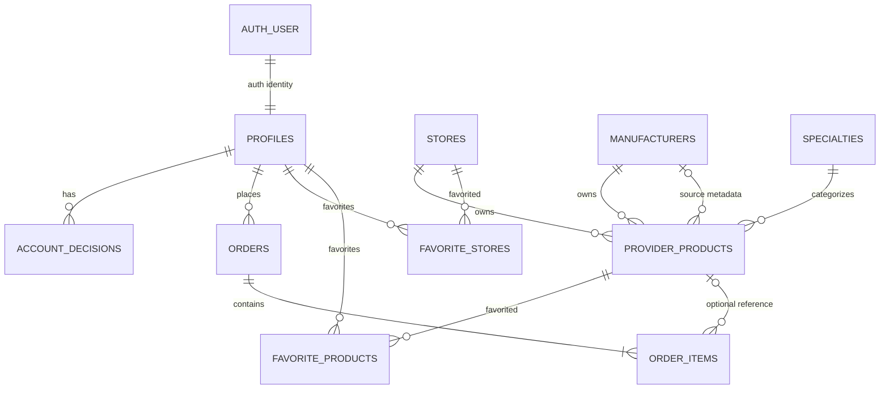

# Finalized MedSupply Supabase Schema Proposal

**Status:** Ready for review. No implementation work performed.

## 1. Final Decision Summary

- Supabase Auth replaces the mock authentication system.
- UUID primary keys are used for every table.
- Mock IDs are retained as `legacy_id` only for migrated entities.
- The initial schema does not include cart, notifications, advertisements, or a separate `pharmacies` table.
- Provider-owned products remain in one table.
- Store favorites and product favorites are persisted.
- Historical order data is snapshot-based.
- Stock is deducted only through atomic order approval.
- Soft deactivation is used for providers and products.
- EGP is the only currency.

## 2. Final Database Tables

### Initial implementation tables

| Table | Purpose |
|---|---|
| `profiles` | Authenticated user profile, role, and pharmacist account status |
| `account_decisions` | Pharmacist approval/rejection/reactivation history |
| `specialties` | Product categories |
| `stores` | Store providers |
| `manufacturers` | Manufacturer providers |
| `provider_products` | Store- and manufacturer-owned product listings |
| `favorite_stores` | Pharmacist store favorites |
| `favorite_products` | Pharmacist provider-product favorites |
| `orders` | One order across any number of providers |
| `order_items` | Historical product/provider/price snapshots |

### Deferred tables

- Cart: remain local/transient.
- Notifications: deferred.
- Advertisements: remain static/local.
- Pharmacies: no separate table.

## 3. Final Table Fields

### `profiles`

| Field | Type | Constraints |
|---|---|---|
| `id` | `uuid` | PK, FK to `auth.users(id)` |
| `legacy_id` | `text` | Nullable, unique |
| `role` | enum `user_role` | Not null |
| `full_name` | `text` | Not null |
| `email` | `citext` | Not null, unique |
| `phone` | `text` | Nullable |
| `profile_picture` | `text` | Nullable |
| `pharmacy_name` | `text` | Nullable |
| `pharmacy_address` | `text` | Nullable |
| `account_status` | enum `pharmacist_account_status` | Nullable for admins |
| `rejection_reason` | `text` | Nullable |
| `created_at` | `timestamptz` | Default now |
| `updated_at` | `timestamptz` | Default now |

### `account_decisions`

- `id`
- `profile_id`
- `status`
- `reason`
- `decided_at`

Status values:

- `approved`
- `rejected`
- `inactive`
- `reactivated`

### `specialties`

- `id`
- `legacy_id`
- `name`
- `description`
- `image_url`
- `is_active`
- `created_at`
- `updated_at`

### `stores`

- `id`
- `legacy_id`
- `name`
- `description`
- `image_url`
- `address`
- `location`
- `phone`
- `contact_person`
- `open_hours`
- `rating`
- `status`
- `deleted_at`
- `created_at`
- `updated_at`

The `location` field may use JSONB initially.

### `manufacturers`

- `id`
- `legacy_id`
- Common provider fields
- `certification`
- `production_capacity`
- `status`
- `deleted_at`
- `created_at`
- `updated_at`

### `provider_products`

| Field | Type | Notes |
|---|---|---|
| `id` | `uuid` | PK |
| `legacy_id` | `text` | Nullable, unique |
| `store_id` | `uuid` | Nullable store owner |
| `manufacturer_id` | `uuid` | Nullable manufacturer owner |
| `specialty_id` | `uuid` | Required category |
| `name` | `text` | Required |
| `normalized_name` | generated text | Name matching key |
| `description` | `text` | Nullable |
| `image_url` | `text` | Nullable |
| `dosage` | `text` | Required |
| `normalized_dosage` | generated text | Dosage matching key |
| `package_size` | `text` | Nullable |
| `variant` | `text` | Nullable |
| `barcode` | `text` | Nullable |
| `expiry_date` | `date` | Nullable |
| `source_manufacturer_id` | `uuid` | Nullable descriptive metadata |
| `source_manufacturer_name` | `text` | Historical/provider display metadata |
| `consumer_price` | `numeric(12,2)` | Must be positive |
| `discount_percentage` | `numeric(5,2)` | `0` through `100` |
| `pharmacist_price_after_discount` | generated/stored numeric | Derived |
| `stock_quantity` | `integer` | Non-negative |
| `is_available` | `boolean` | Default true |
| `deleted_at` | `timestamptz` | Soft deletion |
| `created_at` | `timestamptz` | Default now |
| `updated_at` | `timestamptz` | Default now |

### `favorite_stores`

- `pharmacist_id`
- `store_id`
- `created_at`

Composite PK: `(pharmacist_id, store_id)`.

### `favorite_products`

- `pharmacist_id`
- `product_id`
- `created_at`

Composite PK: `(pharmacist_id, product_id)`.

### `orders`

- `id`
- `legacy_id`
- `pharmacist_id`
- `customer_name_snapshot`
- `total_items`
- `total_price`
- `status`
- `created_at`
- `approved_at`
- `rejected_at`
- `completed_at`
- `rejection_reason`
- `stock_deducted`

`total_discount` is not persisted.

### `order_items`

- `id`
- `order_id`
- `product_id`, nullable
- `product_name`
- `dosage`
- `package_size`
- `variant`
- `seller_id` snapshot
- `seller_legacy_id` snapshot
- `seller_name`
- `seller_type`
- `consumer_price`
- `discount_percentage`
- `pharmacist_unit_price`
- `quantity`
- `line_total`

## 4. Relationships and Foreign Keys

- `profiles.id` → `auth.users.id`
- `account_decisions.profile_id` → `profiles.id`
- `provider_products.specialty_id` → `specialties.id`
- `provider_products.store_id` → `stores.id`
- `provider_products.manufacturer_id` → `manufacturers.id`
- `provider_products.source_manufacturer_id` → `manufacturers.id`
- `favorite_stores.pharmacist_id` → `profiles.id`
- `favorite_stores.store_id` → `stores.id`
- `favorite_products.pharmacist_id` → `profiles.id`
- `favorite_products.product_id` → `provider_products.id`
- `orders.pharmacist_id` → `profiles.id`
- `order_items.order_id` → `orders.id`
- `order_items.product_id` → `provider_products.id`, nullable

Provider ownership is never derived through `seller_id` or source-manufacturer metadata.

## 5. Constraints and Uniqueness

### Required enums

- `user_role`
- `pharmacist_account_status`
- `account_decision_status`
- `provider_status`
- `provider_type`
- `order_status`

### Provider-product ownership

Exactly one owner must exist:

```text
(store_id is set XOR manufacturer_id is set)
```

Both-or-neither ownership is invalid.

### Provider uniqueness

Generated normalized name/dosage values should enforce:

- Unique `(store_id, normalized_name, normalized_dosage)` for store listings.
- Unique `(manufacturer_id, normalized_name, normalized_dosage)` for manufacturer listings.
- Store and manufacturer providers may contain identical names/dosages.

### Pricing and inventory checks

- Consumer price greater than zero.
- Discount between 0 and 100 inclusive.
- Stock quantity greater than or equal to zero.
- True availability requires stock greater than zero.
- Pharmacist price is generated from consumer price and discount.
- Quantity in order items must be positive.
- Order total items must be non-negative.

### Account status checks

- Admin profiles have no pharmacist status requirement.
- Pharmacist profiles require an account status.
- Rejected accounts should have a rejection reason.
- Other statuses should generally clear the rejection reason.

## 6. Derived vs Stored Fields

### Derived/generated

- `provider_products.normalized_name`
- `provider_products.normalized_dosage`
- `provider_products.pharmacist_price_after_discount`
- Order line total
- Order total
- Order total discount
- Order item consumer versus pharmacist price difference

### Historical snapshots stored in orders

- Product name
- Dosage
- Package size
- Variant
- Provider name/type/ID
- Consumer price
- Discount
- Pharmacist price
- Quantity
- Line total

`total_discount` should be calculated as:

```text
consumer price × quantity − line total
```

It should not be a stored order field.

## 7. Index Strategy

- `profiles(email)`
- `profiles(role, account_status)`
- `account_decisions(profile_id, decided_at DESC)`
- `provider_products(store_id, is_available, deleted_at)`
- `provider_products(manufacturer_id, is_available, deleted_at)`
- `provider_products(specialty_id, is_available)`
- `provider_products(stock_quantity)`
- Partial indexes for active, non-deleted listings
- `favorite_stores(pharmacist_id)`
- `favorite_products(pharmacist_id)`
- `orders(pharmacist_id, status, created_at DESC)`
- `orders(status, created_at DESC)`
- `order_items(order_id)`
- `order_items(product_id)`
- `order_items(seller_type, seller_id)`

## 8. Final RLS Access Matrix

| Resource | Anonymous | Active pharmacist | Pending/rejected/inactive | Admin |
|---|---|---|---|---|
| Profile | None | Own profile | Own profile/status only | Read/update all |
| Account decisions | None | Own decisions may be read | Own status only | Full access |
| Active specialties | Read | Read | No protected access | Full CRUD |
| Active stores/manufacturers | Read | Read | No protected access | Full CRUD/status |
| Active provider products | Read | Read | No protected access | Full CRUD/status/stock |
| Favorites | None | Own rows only | None | No direct need |
| Orders | None | Own orders only | None | Read/update via workflow operations |
| Order items | None | Own order items | None | Read all |

### Security rules

- Admin role comes only from the server-validated `profiles.role`.
- User role and account status cannot be changed through public profile updates.
- Pharmacist protected operations require `account_status = 'active'`.
- Pending/rejected/inactive users must not read orders, favorites, or protected inventory operations.
- Direct inventory stock updates are allowed only for Admin workflows.
- Order-item access inherits ownership from its parent order.
- Public API key is never sufficient to grant Admin access.

## 9. RPC/Transaction Requirements

### `create_order`

**Invoker:** Active pharmacist.

**Validations:**

- Pharmacist ownership and active status.
- Cart is not empty.
- Product exists and is not deleted.
- Product and provider are active.
- Stock covers every requested quantity.
- Current pricing is captured at submission.

**Tables:** Reads profiles, stores/manufacturers, and provider products; writes orders and order_items.

**Atomic:** Required.

**Duplicate prevention:** Server request ID or submission token.

**Returns:** Order ID, status, and created timestamp.

### `approve_order`

**Invoker:** Admin only.

**Validations:**

- Order exists.
- Status is Pending.
- `stock_deducted` is false.
- All products/providers remain valid.
- Aggregated quantity does not exceed available stock.

**Locking:** Lock the order and affected provider-product rows.

**Atomic:** Required.

**Duplicate prevention:** Status plus `stock_deducted` guard inside the transaction.

**Stock deduction:** Exactly once.

### `reject_order`

**Invoker:** Admin only.

**Validations:**

- Order is Pending.
- Rejection reason is present.

**Atomic:** Status, timestamp, and reason update.

Approved, rejected, and completed orders cannot pass this workflow again.

### `complete_order`

**Invoker:** Admin only.

**Validations:**

- Order is Approved.
- Order is not already Completed.

**Atomic:** Required.

**Stock:** Never modified.

### `set_pharmacist_status`

**Invoker:** Admin only.

**Allowed lifecycle:**

- Pending → Active
- Pending → Rejected
- Rejected → Active
- Active → Inactive
- Inactive → Active

**Atomic:** Updates profile and appends account decision.

### Favorite toggles

**Invoker:** Active pharmacist only.

**Validations:**

- Product/store exists.
- Pharmacist identity comes from `auth.uid()`.
- No client-supplied ownership ID.

**Atomic:** One composite-key insert/delete operation.

## 10. Deactivation and Deletion Strategy

### Providers

- Use `status = inactive` for existing UI behavior.
- Use `deleted_at` only for soft removal.
- Never physically delete providers with historical order items.

### Products

- Use `is_available = false` for deactivation.
- Use `deleted_at` for soft removal.
- Keep the provider-product row for favorites and historical orders.
- Set `order_items.product_id` to null if the current listing is removed.

### Hard deletion

Not recommended for providers, provider products, orders, order items, or profiles.

## 11. Auth and Admin Provisioning

### Public registration

- Creates only a pharmacist profile.
- Account status starts as pending.
- Role and status are server-controlled.
- Public registration cannot create Admin accounts.

### Profile creation

Use a database Auth trigger or equivalent server mechanism:

- Trigger on new Supabase Auth user.
- Ignore role/status supplied by client metadata.
- Set pharmacist role and pending status.

### Initial Admin provisioning

Recommended:

1. Provision the first Admin through the Supabase Dashboard and one-time server operation.
2. Assign the role in `profiles`, never public metadata or registration.
3. Rotate or remove bootstrap credentials.
4. Disable public Admin registration.

## 12. Data Migration Strategy

1. Specialties
2. Stores
3. Manufacturers
4. Provider products
5. Supabase Auth users
6. Profiles
7. Account decisions
8. Product and store favorites
9. Historical orders
10. Historical order items
11. Enable RLS and RPC operations

Existing password hashes cannot be migrated. Migration users require password reset or verified credential provisioning.

## 13. Remaining Risks

- Pending/rejected/inactive login blocking requires Auth Hooks or post-login enforcement.
- Soft deletion requires consistent application filtering.
- Source-manufacturer metadata should remain descriptive metadata.
- Cart persistence is intentionally deferred.
- RLS and RPC policies must prevent direct role/status and stock manipulation.

## Final Mermaid ER Diagram


